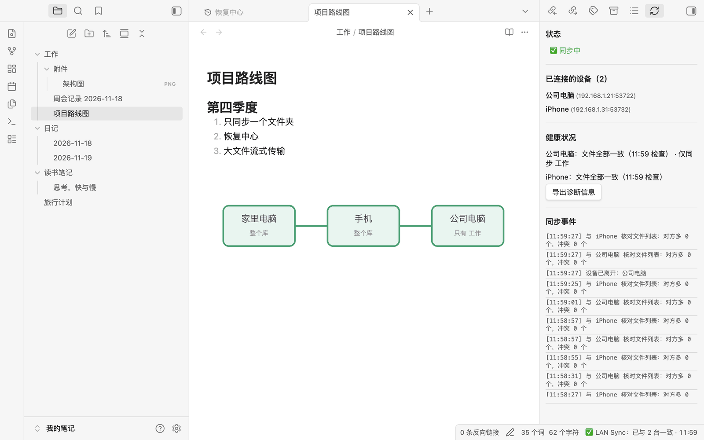
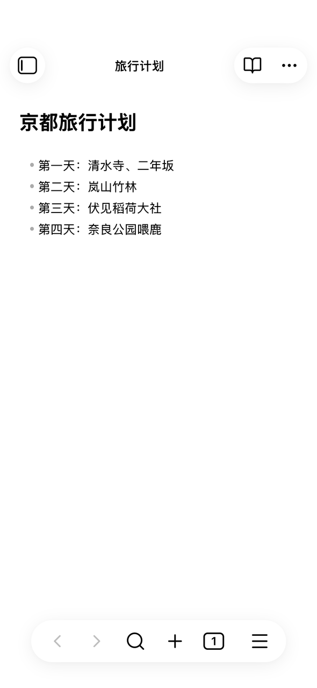
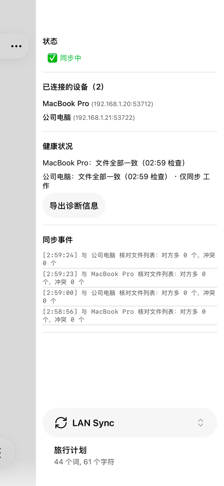
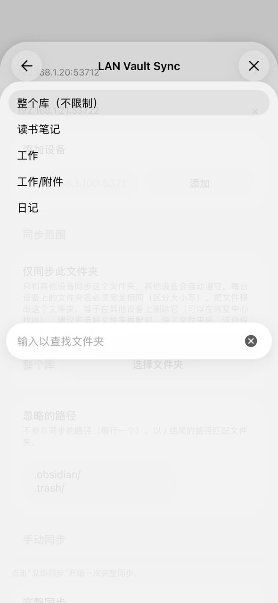
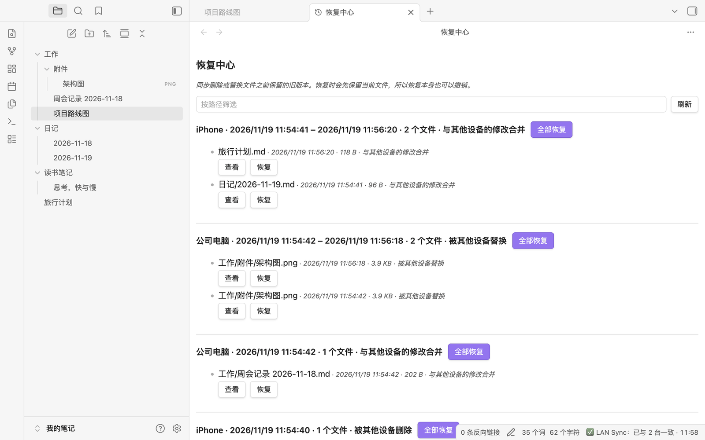
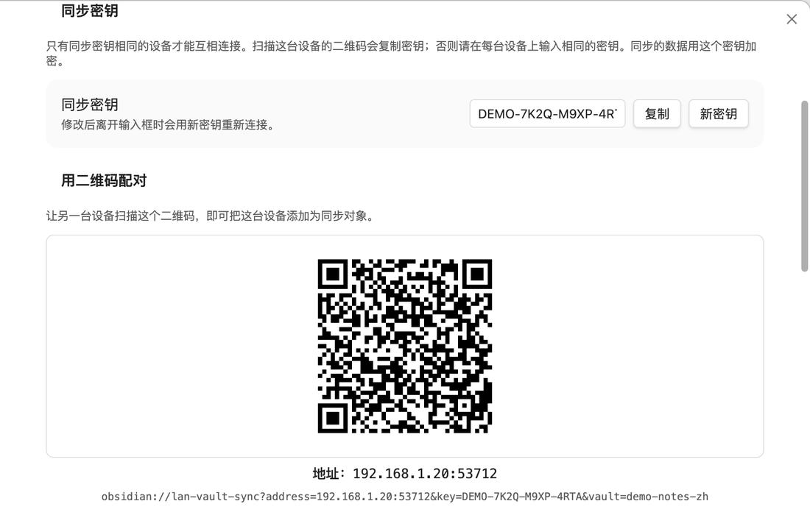
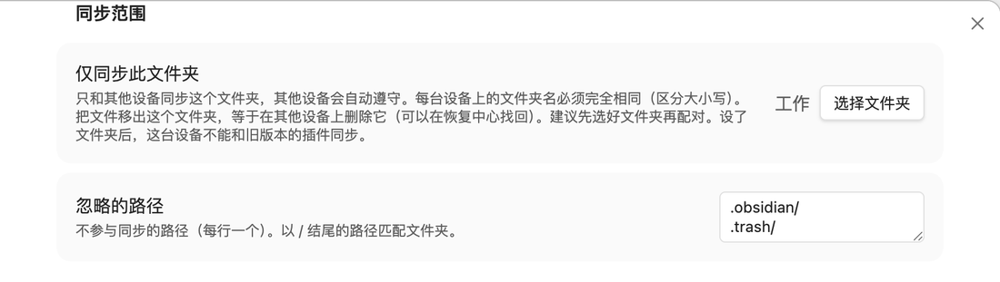

# LAN Vault Sync

> 在局域网里直接同步 Obsidian 仓库：不经过任何云服务，不需要服务器和账号，免费开源。

[English](README.md) | 中文


在电脑上写的笔记，几秒后就出现在同一 Wi-Fi 下的手机上，反过来也一样。数据只在你自己的设备之间传输，并且全程加密。



---

## 亮点

- **数据不出局域网**：设备之间直接连接，不经过任何外部服务器。
- **同时编辑也不冲突**：笔记用 [Yjs](https://github.com/yjs/yjs) CRDT 按字符合并，两台设备离线时各改各的，连上后自动合在一起，不丢字。
- **附件也同步**：图片、PDF 等按内容哈希比对，大文件流式传输、到达后校验。
- **误删能找回**：同步删除或覆盖文件之前会先存一份旧版本，在恢复中心一键放回。
- **删除保护**：一次删掉大量文件、或者同步关闭期间少了很多文件时，先停下来等你确认。
- **只同步一个文件夹**：比如公司电脑只同步 `工作` 文件夹，其他设备自动遵守，别的笔记连文件名都不会传过去。
- **随时知道是否同步好了**：状态栏和同步面板按设备显示“文件全部一致”，有问题会提醒。
- **电脑、手机都能用**：macOS、Windows、Linux、iOS、Android。界面跟随 Obsidian 的语言，支持中文和英文。

## 截图

<table>
  <tr>
    <td align="center"></td>
    <td align="center"></td>
    <td align="center"></td>
  </tr>
  <tr>
    <td align="center">电脑上刚加的一行，手机上马上就有</td>
    <td align="center">同步面板：每台设备是否一致</td>
    <td align="center">选择只同步哪个文件夹</td>
  </tr>
</table>



---

## 安装

### 从社区插件市场安装

1. 打开 **设置 → 第三方插件 → 浏览**。
2. 搜索 **LAN Vault Sync**，点击 **安装**，再点击 **启用**。

### 手动安装

1. 从 [Releases 页面](https://github.com/senjanson/lan-vault-sync/releases) 下载最新版的 `main.js`、`manifest.json` 和 `styles.css`。
2. 在仓库里新建文件夹 `.obsidian/plugins/lan-vault-sync/`，把三个文件放进去。
3. 在 Obsidian 里打开 **设置 → 第三方插件**，关闭安全模式，启用 **LAN Vault Sync**。

每台要同步的设备都要安装，而且最好装同一个版本（见[升级说明](#升级说明)）。

---

## 快速上手

1. **所有设备连到同一个局域网**（同一个 Wi-Fi 或有线网络）。
2. **配对**：让所有设备使用同一个同步密钥。最简单的办法是用手机扫电脑上的二维码，见下一节。
3. **等几秒**：设备会自动找到彼此并开始同步。状态栏出现 “LAN Sync：已与 N 台一致” 就说明同步好了。

### 用二维码配对（推荐）

1. 在电脑上打开 **设置 → LAN Vault Sync**，找到 **用二维码配对**。
2. 用手机相机扫描二维码，按提示在 Obsidian 中打开。
3. 插件会问你是否与这台电脑配对。确认后，手机会记下电脑的地址，并改用二维码里的同步密钥和仓库 ID。



电脑有多个网卡（比如同时连着 Wi-Fi 和网线）时，二维码上方会出现 **网络接口** 下拉框，选手机所在网络的那个地址。

### 同步密钥

只有同步密钥相同的设备才能互相连接，同步的内容也用它加密。每台设备第一次启动时会生成一个随机密钥。扫码配对会自动带上密钥；不扫码的话，就把同一个密钥填到每台设备的 **设置 → LAN Vault Sync → 同步密钥** 里。密钥不一致时会弹出提示。

### 按地址添加设备

设备之间靠 UDP 广播互相发现。访客网络、公司网络有时会屏蔽广播，这时可以手动添加：

1. 在电脑的设置页里记下二维码下面显示的地址，例如 `192.168.1.20:53712`。
2. 在另一台设备上打开 **设置 → LAN Vault Sync → 按地址添加的设备**，填入这个地址，点 **添加**。也可以用命令 **按地址添加设备**。

---

## 日常使用

### 状态栏和同步面板

状态栏显示这台设备是否和其他设备一致，例如 “LAN Sync：已与 2 台一致 · 11:56”。时间是上次比对一致的时间：今天的只显示时刻，更早的会带上日期。如果有文件还没同步好、或者有需要你处理的事，状态栏会显示出来。

点击状态栏，或运行命令 **打开同步面板**，可以看到：

- 已连接的设备和它们的地址；
- 每台设备的 **健康状况**：文件是否全部一致，什么时候检查的。只同步一个文件夹的设备后面会标注 “仅同步 工作”；
- 断开的设备也会一直列着，显示 “已断开 · 上次同步 11-18 14:02”，重启 Obsidian 后也还在，30 天没见到才去掉；
- 需要你处理的提醒（可以点“知道了”关掉）和最近的同步事件；
- **导出诊断信息** 按钮。

### 恢复中心（版本历史）

同步在删除或覆盖文件之前，会把旧版本存到 `.lan-vault-sync/history/`，默认保留 30 天。运行命令 **打开恢复中心**，可以按设备和时间看到每一批改动：哪台设备、什么时候、删除还是覆盖。点 **查看** 看内容，点 **恢复** 放回原处，或者点 **全部恢复** 放回整批。恢复前会先保存当前文件，所以恢复本身也能撤销。

手机上版本历史默认最多占 500 MB，超过时从最旧的开始删（设置 **手机上的空间上限**）。

### 删除保护

下面两种情况，插件不会直接删除，而是在同步面板里列出来，等你选 **删除** 或 **保留**：

- 同步关闭期间，这台设备上少了很多文件（一次超过 20 个，或超过库的 5% 且至少 10 个）。可能是你确实删了，也可能是别的工具或同步软件误删了。
- 另一台设备在两分钟内删除的文件超过整个库的一半（且至少 10 个）。移动和改名不算删除。

### 仅同步一个文件夹

有时候一台设备只应该拿到库里的一部分。比如整个库在家里电脑和手机之间同步，公司电脑只同步 `工作` 文件夹，其他笔记连文件名都不能传到公司电脑上。公司和家里不在一个局域网也没关系：手机在公司和公司电脑同步，回家再和家里电脑同步，改动会经手机传过去。

在公司电脑上打开 **设置 → LAN Vault Sync → 同步范围 → 仅同步此文件夹**，点 **选择文件夹**，选 `工作`。电脑和手机用的是同一个选择框。



其他设备不用设置。每台设备连接时会说明自己同步的文件夹，对方自动遵守：只把这个文件夹里的内容发过去，对方发来的这个文件夹以外的内容也不接收。

- **文件夹名要完全相同。** 文件夹按路径对应，每台设备上的名字必须一样，包括大小写（`Work` 和 `work` 是两个文件夹）。某台设备上没有这个文件夹时，同步面板会提醒。
- **移出等于删除，移入等于新增。** 把文件移出这个文件夹，在只同步这个文件夹的设备上它会被删除，旧版本进恢复中心；把文件移进来，它就会被同步过去。
- **先选文件夹，再配对。** 在这台设备第一次同步前设好，库里的其他内容就不会传到它上面。
- **之后改设置也不会误删。** 改回整个库，这台设备会收到其余的文件；再改成一个文件夹，范围外已有的文件原样保留，两边都不会被删除。
- **不和旧版本同步。** 设了文件夹的设备不和不支持这项设置的旧版插件同步，并提示对方版本较旧。没设文件夹的设备照常和旧版本同步。
- **文件夹名会明文发送。** 两台设备连接时，在建立加密连接之前会互相发送各自的文件夹名。
- 目前只能选一个文件夹。**忽略的路径** 在文件夹里照样生效。

### 大文件

大文件按块传输，先收在临时位置，全部收完、校验哈希通过后才放进库里，传到一半断开不会留下不完整的文件。手机默认最多接收 200 MB 的文件（设置 **接收文件的大小上限**），更大的文件不会发给它，同步面板里会单独列出，不算“未一致”。

### 导出诊断信息

出了问题时，运行命令 **导出诊断信息（同步密钥已遮盖）**，或点同步面板里的 **导出诊断信息**。诊断文件写到 `.lan-vault-sync/diagnostics/`，并复制到剪贴板，里面的同步密钥已经遮掉。

### 命令

在命令面板（`Cmd/Ctrl + P`）里搜索 “LAN Vault Sync”：

| 命令 | 作用 |
|---|---|
| 开启或关闭同步 | 启动或停止同步 |
| 打开同步面板 | 在侧边栏打开同步面板 |
| 打开恢复中心 | 查看并恢复被同步删除或覆盖的版本 |
| 打开同步日志 | 查看被覆盖、被删除的文件记录 |
| 按地址添加设备 | 输入 `IP:端口` 添加设备 |
| 导出诊断信息（同步密钥已遮盖） | 导出诊断文件 |

---

## 设置

| 设置项 | 默认值 | 说明 |
|---|---|---|
| 启用同步 | 开 | 总开关 |
| 设备名称 | 自动生成 | 其他设备上显示的名字 |
| 设备 ID | 自动生成 | 每台设备都必须不同。两台设备显示同一个 ID 时（比如复制了整个库），点 **换新设备 ID** |
| 端口 | 首次启动时随机分配（49200–65000） | 接受连接的端口。手机只主动连接电脑，不需要改 |
| 同步密钥 | 随机生成 | 只有密钥相同的设备才能连接，也用于加密。可以复制，或点 **新密钥** 重新生成 |
| 仅同步此文件夹 | 整个库 | 这台设备只同步的文件夹，其他设备自动遵守（见[仅同步一个文件夹](#仅同步一个文件夹)） |
| 忽略的路径 | `.obsidian/`、`.trash/` | 不参与同步的路径，每行一个，按开头匹配。以 `/` 结尾的表示文件夹 |
| 同步检查间隔 | 30 秒 | 定期完整比对一次文件列表。填 0 关闭（改动仍会实时同步） |
| 调试日志 | 关 | 在开发者控制台输出详细日志 |
| 接收文件的大小上限（MB） | 手机 200，电脑 0（不限） | 其他设备发来的更大文件不接收 |
| 旧版本保留天数 | 30 | 版本历史保留多久 |
| 手机上的空间上限（MB） | 500 | 手机上版本历史最多占多少空间，0 表示不限 |
| 启用同步日志 / 日志条数上限 | 开 / 500 | 记录被覆盖和被删除的文件 |

---

## 常见问题

**手机连不上电脑？**
确认两台设备在同一个 Wi-Fi，而且不是会隔离设备的访客网络。iPhone 要允许 Obsidian 使用本地网络（**设置 → 隐私与安全性 → 本地网络**）。广播被屏蔽时，用二维码或[按地址添加设备](#按地址添加设备)。同步面板会显示连不上的地址。

**提示某台设备上的 LAN Vault Sync “版本较旧”或“版本较新”？**
所有设备要装同一个大版本的插件。提示里会写出是哪台设备需要更新。

**提示某台设备“属于另一个库”？**
每个库有自己的 ID，随配对二维码和链接传递。在这台设备上重新扫一次另一台设备的二维码即可。

**提示“另一台设备和本设备用的是同一个 ID”？**
通常是连同 `.obsidian` 文件夹复制了整个库。在其中一台的设置里点 **换新设备 ID**。

**手机切到后台后还会同步吗？**
系统会暂停后台的 Obsidian。回到 Obsidian 后会自动重新连接，把期间的改动补上。

---

## 工作原理

```
  电脑 A                                  手机 B
┌──────────────────┐   加密的 WebSocket   ┌──────────────────┐
│ Obsidian         │◄────────────────────►│ Obsidian         │
│ + LAN Vault Sync │   笔记：Yjs 增量      │ + LAN Vault Sync │
└──────────────────┘   附件：按块传输      └──────────────────┘
          ▲                                        │
          └────────── UDP 广播（自动发现）───────────┘
```

1. 每台设备通过 UDP 广播（端口 53713）告诉同一网段的其他设备自己在哪里。
2. 设备之间建立 WebSocket 连接，先用同步密钥互相验证，之后的内容全部加密。
3. 双方交换文件列表，找出对方缺的、不同的文件，以及删除记录。
4. **笔记**（`.md`、`.txt`、`.canvas` 等纯文本）用 Yjs CRDT 同步，多台设备同时或离线编辑时自动按字符合并。
5. **附件**按 SHA-256 哈希比对，大文件按块流式传输，到达后校验。

### 冲突怎么处理

| 文件类型 | 处理方式 |
|---|---|
| 笔记 | 按字符自动合并，两边的修改都保留 |
| 附件，只有一边改了 | 以改动的一边为准 |
| 附件，两边都改了 | 较晚的版本留下。另一个版本存进版本历史；如果它只在这台设备上，还会在旁边留一份 `名字 (conflict 1a2b3c).扩展名` |

### 手机上的限制

- 手机系统不允许 Obsidian 接受连接，所以手机只能主动连接电脑。局域网里至少要有一台开着 Obsidian 的电脑。
- 手机上自动发现可能不可用，建议用二维码配对。

### 隐私与安全

- 所有数据只在局域网内传输，不发往任何外部服务器。没有账号，不收集数据，没有遥测。
- 只有知道同步密钥的设备能连接，密钥本身不在网络上传输。
- 同步内容用由同步密钥派生、每次连接都不同的密钥加密（AES-256-GCM），同一网络里的其他人无法读取或篡改。
- 设了“仅同步此文件夹”的设备，在连接时会不加密地发送这个文件夹的名字。

### 插件在库里存的东西

- `.lan-vault-sync/`：版本历史（`history/`）、同步日志、诊断导出、正在接收的文件，以及每台设备上次同步的时间。Obsidian 不显示这个文件夹，也不会同步它。如果你还用别的同步或备份工具，可以把它排除；删掉它只会丢失版本历史、日志和设备的上次同步时间，不影响笔记。
- `.obsidian/plugins/lan-vault-sync/`：插件设置和笔记的 CRDT 状态。状态文件先写临时文件再改名，并保留上一份备份，保存途中崩溃也不会丢失记录。

---

## 升级说明

所有设备要同时升级，不同大版本的插件之间不能同步，连上时会提示是哪台设备需要更新。

<details>
<summary><b>升级到 0.5</b></summary>

- 使用同步协议 3，不能与 0.4 及更早版本同步。
- 库里多了 `.lan-vault-sync/` 文件夹，存放版本历史、日志和诊断。
- 每个库现在有自己的 ID，随配对二维码和链接传递，同名的两个库不会再混淆。之前配对的设备照常工作：重新配对前，仍用库的文件夹名代替 ID。
- 新增恢复中心。只有一方改动的附件不再生成冲突副本。
- 大文件改为流式传输，手机默认最多接收 200 MB。
- 两台设备用了同一个设备 ID 时会提示。
- 去掉了“冲突策略”设置：所有冲突都保留两个版本。

</details>

<details>
<summary><b>升级到 0.4</b></summary>

- 同步内容开始加密，不能与 0.3 及更早版本同步。
- 命令按 Obsidian 规范改了名字，以前设的快捷键要重新设置。
- 升级后第一次连接会把所有笔记再传一遍，之后只传有差异的。

</details>

---

## 开发

```bash
git clone https://github.com/senjanson/lan-vault-sync
cd lan-vault-sync
npm install

npm run dev     # 开发构建，保存后自动重新编译
npm run build   # 生产构建
npm test        # 运行测试
```

把构建出的 `main.js`、`manifest.json`、`styles.css` 复制（或软链接）到测试库的 `.obsidian/plugins/lan-vault-sync/`。配合社区插件 **Hot Reload**，每次构建后会自动重载插件。

---

## 路线图

- [x] 二维码配对
- [x] 同步内容加密
- [x] 版本历史和恢复中心
- [x] 一台设备只同步一个文件夹，其他设备自动遵守
- [ ] 同步多个文件夹，或对不同设备同步不同文件夹
- [ ] 逐个文件的同步进度
- [ ] 附件冲突的对比界面
- [ ] 用 mDNS / Bonjour 发现设备，作为 UDP 广播的补充

---

## 贡献

欢迎提交 Issue 和 Pull Request。较大的改动建议先开 Issue 讨论。

## 许可证

[MIT](LICENSE)

## 致谢

- [Yjs](https://github.com/yjs/yjs)：Kevin Jahns 开发的 CRDT 框架
- [ws](https://github.com/websockets/ws)：Node.js 的 WebSocket 库
- [fast-diff](https://github.com/jhchen/fast-diff)：文本差异算法
- [Obsidian](https://obsidian.md)
