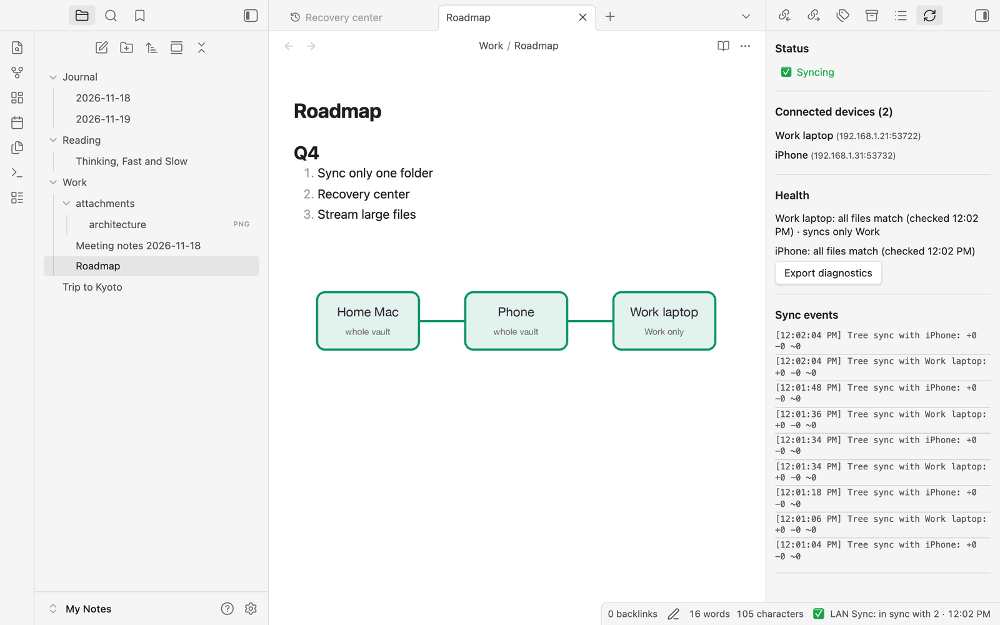
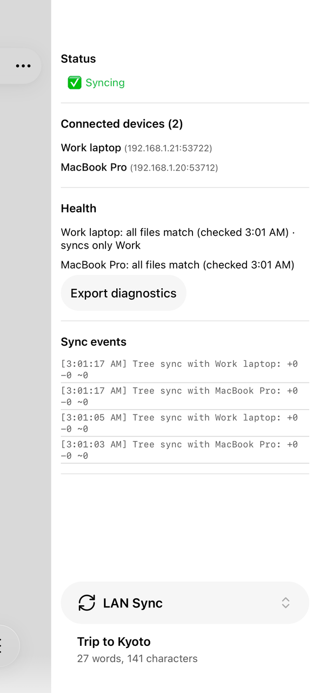
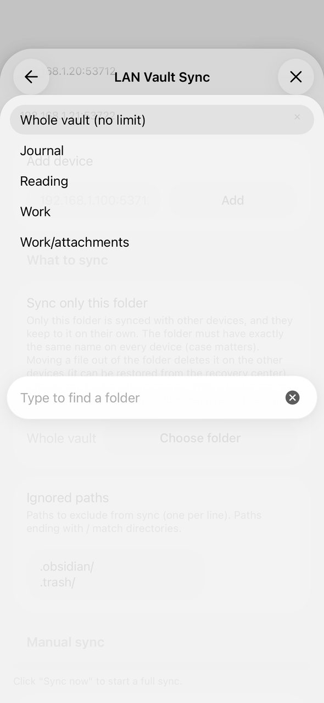
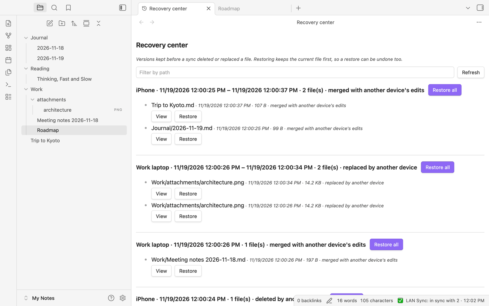
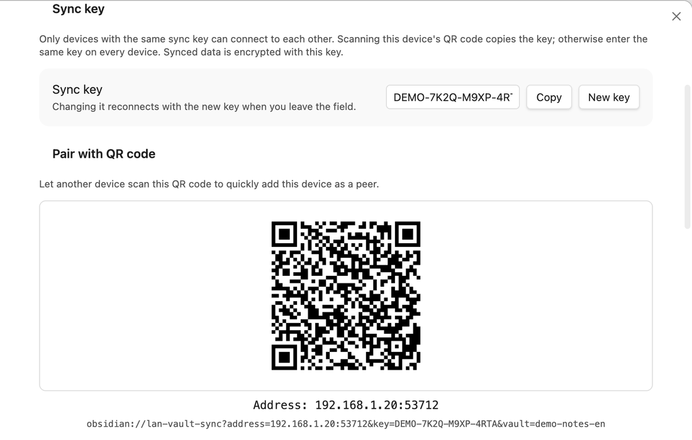
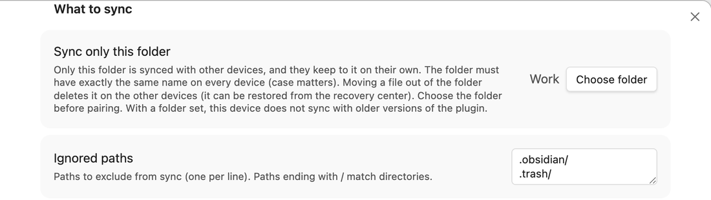

# LAN Vault Sync

> Sync your Obsidian vault directly over your local network. No cloud, no server, no account. Free and open source.

English | [中文](README-zh.md)


Write a note on your computer and it shows up on your phone on the same Wi-Fi a few seconds later, and the other way round. Your data only travels between your own devices, encrypted all the way.



---

## Highlights

- **Your data stays on your network.** Devices connect to each other directly; nothing goes through an outside server.
- **Edit anywhere, no conflicts.** Notes are merged character by character with the [Yjs](https://github.com/yjs/yjs) CRDT. Edit on two devices while they are apart, and the edits come together when they meet again. Nothing is lost.
- **Attachments too.** Images, PDFs and other files are compared by content hash; large files are streamed and checked when they arrive.
- **Undo a sync.** Before a sync deletes or replaces a file, the old version is kept. Put it back from the recovery center.
- **Deletion guard.** When many files are deleted at once, or many are missing after sync was off, sync stops and asks you first.
- **Sync only one folder.** For example, the work laptop syncs only `Work`. The other devices keep to it on their own, and not even the names of your other notes reach that laptop.
- **Always know where you stand.** The status bar and sync panel show whether all files match on each device, and tell you when something needs you.
- **Desktop and mobile.** macOS, Windows, Linux, iOS and Android. The interface follows Obsidian's language: English and Chinese.

## Screenshots

<table>
  <tr>
    <td align="center"></td>
    <td align="center"></td>
    <td align="center"></td>
  </tr>
  <tr>
    <td align="center">A line added on the Mac, already on the phone</td>
    <td align="center">The sync panel: is each device in sync?</td>
    <td align="center">Choose the one folder to sync</td>
  </tr>
</table>



---

## Installation

### From Community plugins

1. Open **Settings → Community plugins → Browse**.
2. Search for **LAN Vault Sync**, click **Install**, then **Enable**.

### Manual installation

1. Download `main.js`, `manifest.json` and `styles.css` of the latest release from the [Releases page](https://github.com/senjanson/lan-vault-sync/releases).
2. Create the folder `.obsidian/plugins/lan-vault-sync/` in your vault and put the three files in it.
3. In Obsidian, open **Settings → Community plugins**, turn off Restricted mode, and enable **LAN Vault Sync**.

Install it on every device you want to sync, preferably the same version on all of them (see [Upgrading](#upgrading)).

---

## Getting started

1. **Put all devices on the same local network** (the same Wi-Fi or wired network).
2. **Pair them**: every device needs the same sync key. The easiest way is to scan the QR code on your computer with your phone; see below.
3. **Wait a few seconds**: the devices find each other and start syncing. When the status bar shows "LAN Sync: in sync with N", you are done.

### Pair with a QR code (recommended)

1. On your computer, open **Settings → LAN Vault Sync** and find **Pair with QR code**.
2. Scan the QR code with your phone's camera and open the link in Obsidian.
3. The plugin asks whether to pair with that computer. Confirm, and the phone adds the computer's address and takes over the sync key and vault ID from the QR code.



If your computer has more than one network connection (Wi-Fi and Ethernet, say), a **Network interface** menu appears above the QR code. Pick the address on the phone's network.

### Sync key

Only devices with the same sync key can connect to each other, and the key is also used to encrypt what is synced. Each device makes a random key the first time it starts. Pairing by QR code copies it; otherwise, enter the same key on every device under **Settings → LAN Vault Sync → Sync key**. You are told when a device's key does not match.

### Add a device by address

Devices find each other with UDP broadcasts. Guest and company networks sometimes block them. Then add the device by hand:

1. In the computer's settings, note the address shown under the QR code, for example `192.168.1.20:53712`.
2. On the other device, open **Settings → LAN Vault Sync → Devices by address**, enter that address and click **Add**. The command **Add device by address** does the same.

---

## Everyday use

### Status bar and sync panel

The status bar shows whether this device is in sync with the others, for example "LAN Sync: in sync with 2 · 12:02 PM". The time is when the files last matched: just the time for today, with the date for an earlier day. Files not yet in sync, and anything that needs you, show up there too.

Click the status bar, or run **Open sync panel**, to see:

- the connected devices and their addresses;
- **Health** for each device: whether all files match, and when that was checked. A device that syncs only one folder is marked "syncs only Work";
- devices that are away stay listed as "disconnected · last in sync Nov 18, 2:02 PM", also after Obsidian restarts. A device not seen for 30 days is dropped;
- alerts that need you (click **Dismiss** to close one) and recent sync events;
- the **Export diagnostics** button.

### Recovery center (version history)

Before a sync deletes or replaces a file, the old version is saved to `.lan-vault-sync/history/` and kept for 30 days. Run **Open recovery center** to see each batch of changes: which device, when, and whether files were deleted or replaced. Click **View** to look at a version, **Restore** to put it back, or **Restore all** for the whole batch. The current file is kept before a restore, so a restore can be undone too.

On a phone the version history takes up to 500 MB by default; beyond that the oldest versions go first (setting **Space limit on a phone**).

### Deletion guard

In these two cases nothing is deleted right away. The files are listed in the sync panel, and you choose **Delete them** or **Keep them**:

- Many files are missing on this device since sync last ran: more than 20 at once, or more than 5% of the vault and at least 10. You may have deleted them, or another tool may have.
- Another device deletes more than half of the vault (and at least 10 files) within two minutes. Moves and renames do not count.

### Sync only one folder

Sometimes a device should get only part of the vault. Say the whole vault syncs between your home computer and your phone, and your work laptop should get only the `Work` folder, without even the names of your other notes. Work and home do not need to share a network: the phone syncs with the work laptop at work and with the home computer at home, and carries the changes across.

On the work laptop, open **Settings → LAN Vault Sync → What to sync → Sync only this folder**, click **Choose folder** and pick `Work`. Computers and phones use the same folder list.



The other devices need no setting. Each device says which folder it syncs when it connects, and the other side keeps to it: it sends only what is in that folder and does not take anything outside it.

- **Same name everywhere.** Folders are matched by path, so the folder must have exactly the same name on every device, case included (`Work` and `work` are two folders). The sync panel tells you when a device's folder does not exist here.
- **Moving out deletes, moving in adds.** A file moved out of the folder is deleted on the device that syncs only that folder, and its old version goes to the recovery center. A file moved in is synced over.
- **Choose the folder before pairing.** Set it before the device first syncs, and nothing else in the vault ever reaches it.
- **Changing it later deletes nothing.** Switch back to the whole vault and the device receives the rest. Switch to a folder again and files already outside it stay as they are, on both sides.
- **No sync with older versions.** A device with a folder set does not sync with plugin versions that do not support this, and tells you that device is older. Devices without a folder sync with older versions as before.
- **The folder name is sent unencrypted.** When two devices connect, they tell each other their folder names before the encrypted connection is set up.
- Only one folder can be chosen. **Ignored paths** still apply inside it.

### Large files

Large files are sent in chunks and collected outside the vault; a file is put into the vault only once all of it has arrived and its hash checks out. A transfer cut off halfway leaves nothing half-written behind. A phone takes files of up to 200 MB by default (setting **Largest file to receive**). Larger files are not sent to it; the sync panel lists them apart, and they do not count as out of sync.

### Export diagnostics

When something goes wrong, run **Export diagnostics (sync key masked)**, or click **Export diagnostics** in the sync panel. The file is written to `.lan-vault-sync/diagnostics/` and copied to the clipboard, with the sync key masked.

### Commands

Search for "LAN Vault Sync" in the command palette (`Cmd/Ctrl + P`):

| Command | What it does |
|---|---|
| Turn sync on or off | Start or stop syncing |
| Open sync panel | Open the sync panel in the sidebar |
| Open recovery center | See and restore versions a sync deleted or replaced |
| Open sync log | See which files were replaced or deleted |
| Add device by address | Add a device by `IP:port` |
| Export diagnostics (sync key masked) | Write a diagnostics file |

---

## Settings

| Setting | Default | Description |
|---|---|---|
| Enable sync | On | Turns syncing on or off |
| Device name | Generated | The name other devices show |
| Device ID | Generated | Must differ on every device. If two devices show the same ID (after copying a whole vault, say), click **New device ID** |
| Port | Random on first start (49200–65000) | The port other devices connect to. Phones only connect out; no need to change it |
| Sync key | Random | Only devices with the same key connect; also used for encryption. Copy it, or click **New key** |
| Sync only this folder | Whole vault | The one folder this device syncs; other devices keep to it (see [Sync only one folder](#sync-only-one-folder)) |
| Ignored paths | `.obsidian/`, `.trash/` | Paths not synced, one per line, matched from the start. A path ending in `/` is a folder |
| Sync check interval | 30 s | How often the full file lists are compared. 0 turns it off (changes still sync right away) |
| Debug logging | Off | Detailed log in the developer console |
| Largest file to receive (MB) | Phone 200, computer 0 (no limit) | Larger files from other devices are not taken |
| Keep old versions for (days) | 30 | How long the version history keeps versions |
| Space limit on a phone (MB) | 500 | Most space the version history may take on a phone; 0 for no limit |
| Enable sync log / Max log entries | On / 500 | Records files that were replaced or deleted |

---

## FAQ

**My phone cannot reach my computer.**
Make sure both are on the same Wi-Fi, and that it is not a guest network that keeps devices apart. On iPhone, allow Obsidian to use the local network (**Settings → Privacy & Security → Local Network**). If broadcasts are blocked, pair with the QR code or [add the device by address](#add-a-device-by-address). The sync panel shows addresses it cannot reach.

**"… runs an older (or newer) version of LAN Vault Sync"?**
All devices need the same major version of the plugin. The message says which device to update.

**"… belongs to another vault"?**
Each vault has its own ID, which pairing passes on. Scan the other device's QR code again on this device.

**"Another device uses this device's ID"?**
Usually a whole vault was copied, `.obsidian` folder included. Click **New device ID** in the settings of one of them.

**Does it sync while the phone is in the background?**
The system pauses Obsidian in the background. When you return to Obsidian it reconnects and catches up.

---

## How it works

```
  Computer A                              Phone B
┌──────────────────┐  encrypted WebSocket ┌──────────────────┐
│ Obsidian         │◄────────────────────►│ Obsidian         │
│ + LAN Vault Sync │   notes: Yjs updates │ + LAN Vault Sync │
└──────────────────┘   files: chunks      └──────────────────┘
          ▲                                        │
          └──────── UDP broadcast (discovery) ─────┘
```

1. Each device announces itself to the local network with UDP broadcasts (port 53713).
2. Devices open WebSocket connections, prove to each other that they know the sync key, and encrypt everything after that.
3. They exchange file lists to find files the other lacks or has in another version, and deletions.
4. **Notes** (`.md`, `.txt`, `.canvas` and other plain text) sync through the Yjs CRDT, so edits made at the same time or offline merge character by character.
5. **Attachments** are compared by SHA-256 hash; large ones are streamed in chunks and checked on arrival.

### Conflicts

| File type | What happens |
|---|---|
| Notes | Merged character by character; both sides' edits are kept |
| Attachments changed on one side | The changed version is kept |
| Attachments changed on both sides | The later version is kept. The other goes to the version history; if it existed only on this device, a copy `name (conflict 1a2b3c).ext` is also kept next to the file |

### On phones

- Phones do not let Obsidian accept connections, so a phone always connects to a computer. At least one computer running Obsidian must be on the network.
- Discovery may not work on a phone; pair with the QR code.

### Privacy and security

- Everything stays on your local network; nothing is sent to an outside server. No account, no data collection, no telemetry.
- Only devices that know the sync key can connect; the key itself never goes over the network.
- What is synced is encrypted with AES-256-GCM, with a key derived from the sync key and different for every connection, so others on the same network cannot read or change it.
- A device set to sync only one folder sends that folder's name unencrypted when it connects.

### What the plugin keeps in your vault

- `.lan-vault-sync/`: the version history (`history/`), sync logs, diagnostics, files being received, and when each device was last in sync. Obsidian does not show this folder and does not sync it. If you also use another sync or backup tool you may exclude it; deleting it loses only the version history, the logs and those times, not your notes.
- `.obsidian/plugins/lan-vault-sync/`: the plugin's settings and the CRDT state of your notes. State files are written to a temporary file and renamed, with the previous copy kept as a backup, so a crash while saving loses nothing.

---

## Upgrading

Upgrade all devices together: different major versions of the plugin do not sync with each other, and you are told which device to update.

<details>
<summary><b>Upgrading to 0.5</b></summary>

- Uses sync protocol 3 and does not sync with 0.4 or earlier.
- Adds the `.lan-vault-sync/` folder for the version history, logs and diagnostics.
- Each vault now has its own ID, passed on by the pairing QR code and link, so two vaults with the same name are no longer mixed up. Devices paired before keep working: until they pair again, the vault's folder name stands in for the ID.
- Adds the recovery center. An attachment changed on one side no longer leaves a conflict copy.
- Large files are streamed; a phone takes files of up to 200 MB by default.
- Two devices with the same device ID are detected.
- The "Conflict strategy" setting is gone: every conflict keeps both versions.

</details>

<details>
<summary><b>Upgrading to 0.4</b></summary>

- What is synced is now encrypted; does not sync with 0.3 or earlier.
- Commands were renamed to follow Obsidian's guidelines; set their hotkeys again.
- The first connection after upgrading sends all notes once more; after that only notes that differ.

</details>

---

## Development

```bash
git clone https://github.com/senjanson/lan-vault-sync
cd lan-vault-sync
npm install

npm run dev     # development build, rebuilds on save
npm run build   # production build
npm test        # run the tests
```

Copy (or symlink) the built `main.js`, `manifest.json` and `styles.css` into `.obsidian/plugins/lan-vault-sync/` of a test vault. With the **Hot Reload** community plugin, the plugin reloads after every build.

---

## Roadmap

- [x] Pairing by QR code
- [x] Encrypted sync
- [x] Version history and recovery center
- [x] A device syncs only one folder; the others keep to it
- [ ] Several folders, or different folders for different devices
- [ ] Per-file sync progress
- [ ] A comparison view for attachment conflicts
- [ ] mDNS / Bonjour discovery alongside UDP broadcast

---

## Contributing

Issues and pull requests are welcome. For larger changes, please open an issue first.

## License

[MIT](LICENSE)

## Acknowledgements

- [Yjs](https://github.com/yjs/yjs): the CRDT framework by Kevin Jahns
- [ws](https://github.com/websockets/ws): WebSocket library for Node.js
- [fast-diff](https://github.com/jhchen/fast-diff): text diffing
- [Obsidian](https://obsidian.md)
